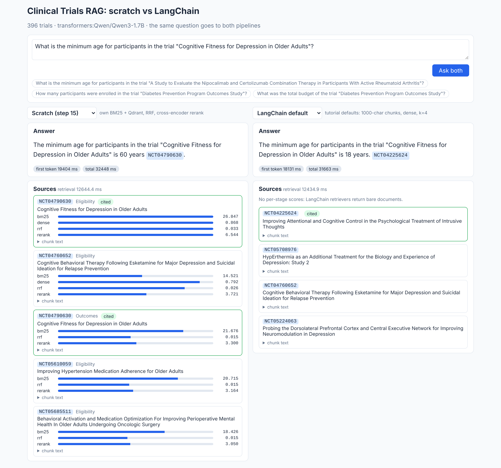
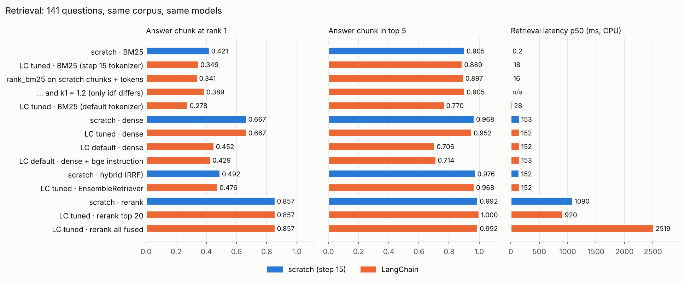
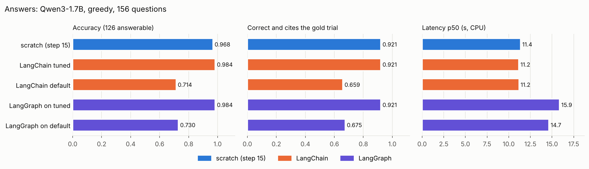
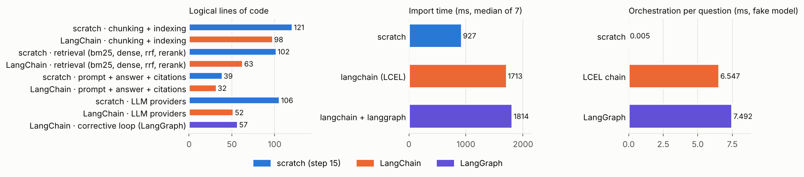
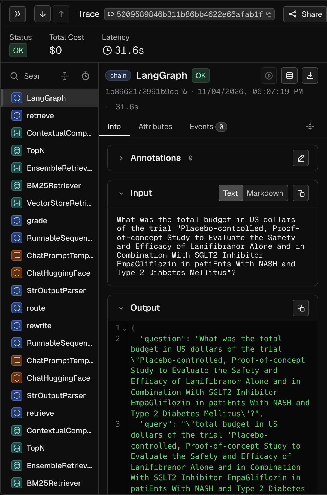
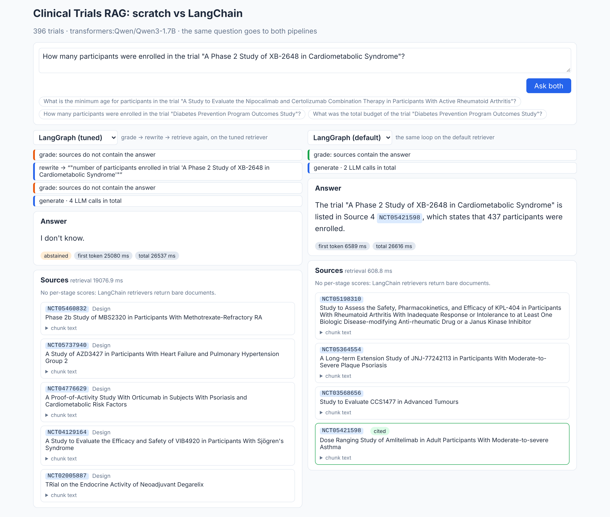

# 21 · RAG from scratch vs LangChain / LangGraph

🇸🇰 [Slovenská verzia](README.sk.md)

## TL;DR
- **Same data, same 156 questions, same scorer, same Qwen3-1.7B, same CPU machine**: step 15's hand-written RAG vs
  the same app built from LangChain and LangGraph parts. Step 15 was re-run here and reproduced its numbers exactly
  (accuracy 0.968, grounded 0.921).
- **LangChain configured like step 15 is as good: accuracy 0.984 vs 0.968** (2 questions, inside the noise), the same
  0.921 grounded, the same latency, with **245 vs 368 lines of code**.
- **LangChain with the tutorial's defaults is much worse: accuracy 0.714, grounded 0.659.** The answer chunk is in
  the top 5 for 0.706 of questions vs 0.968: 1000-character chunks without the trial title lose the link between
  a fact and its trial. The framework doesn't make retrieval good; the chunking decisions do.
- **A LangGraph "grade → rewrite → retrieve again" loop added +31–42 % latency and changed 0 of 156 verdicts on the
  good retriever, +2 on the weak one.** The 1.7B grader said "the sources contain the answer" for 33 of 41
  questions where they did not.
- **Cost of the framework:** +37 packages (+87 MB), import 1.7 s vs 0.9 s, ~7 ms of orchestration per question
  (vs 11 s for the answer), and a handful of silent defaults that had to be found and fixed by hand
  (`BM25Retriever` ranks the answer chunk first 0.341 vs 0.421 on identical chunks; Qwen3 "thinking" can't be
  switched off through `ChatHuggingFace`; RAGAS 0.4.3 doesn't import with langchain-community 0.4).



## Problem
[Step 15](https://github.com/kavicka/15-rag-fullstack-clinical) built a RAG app over clinical trials without a
framework: own BM25, own fusion, own prompt and citation check, own LLM layer. Most job ads for AI engineers ask for
LangChain or LangGraph instead. This step answers, with numbers, what the framework actually changes:
1. **Quality.** Does a LangChain pipeline answer as well as the hand-written one: with the tutorial's defaults, and
   when configured to do the same thing?
2. **Engineering.** How much code, how many dependencies, how much import time and runtime overhead?
3. **What the framework adds.** A LangGraph loop that grades the sources and rewrites the query, and tracing,
   neither of which step 15 has. What do they buy?

## Setup
- **Same data and eval as step 15.** The 396 trials from `eval/study_ids.txt` are downloaded again
  (694,284 words, identical to step 15; all 156 gold facts are still in the records). Eval: the same
  `eval/questions.jsonl` (126 answerable short-fact questions, 30 unanswerable) and the same rule scorer
  (`rag/scoring.py`).
- **Same models everywhere.** Embeddings `BAAI/bge-small-en-v1.5`, reranker `cross-encoder/ms-marco-MiniLM-L-6-v2`,
  LLM `Qwen/Qwen3-1.7B` through transformers, greedy, thinking off, 256 new tokens, 5 chunks in the prompt
  (LangChain default: 4). The prompt text is the same in all variants: it is the task specification, not a
  framework feature. A check confirmed that the LangChain chat model and step 15's LLM layer produce the
  identical answer for the same prompt.
- **Same machine for every number:** a cloud Linux VM, 4 CPU cores, no GPU. Step 15 was re-run here, so its
  numbers in this README are from this machine, not copied from step 15.
- **Code.** `rag/` is step 15's package, vendored unchanged (commit `e9e17e1`). `lc/` is everything LangChain.
  `pipelines.py` puts both behind one `stream(question)` interface used by the eval and the API.
- Versions: langchain 1.4.8, langchain-core 1.7.4, langchain-classic 1.0.8, langchain-community 0.4.2,
  langchain-huggingface 1.2.3, langchain-qdrant 1.1.0, langgraph 1.2.19, transformers 5.22.1, torch 2.15.0.

## How it works
```
                 ┌ scratch     rag/ (step 15)   own BM25 + Qdrant, RRF, cross-encoder, own LLM layer
question ─► pipelines.py ┼ lc_default  lc/  tutorial defaults: RecursiveCharacterTextSplitter → dense k=4
                 ├ lc_tuned    lc/  section chunks, BM25Retriever + Qdrant → EnsembleRetriever → reranker
                 └ lg_*        lc/graph.py  LangGraph: retrieve → grade → (rewrite → retrieve) → generate
                         │
                         ▼  stream(): ("sources", chunks) → ("token", …) → ("step", …)
              eval/run_eval.py (same questions, same scorer)  ·  api/main.py (SSE)  ·  React UI (two lanes)
```
- **LC default = the LangChain RAG tutorial** (`lc/index.py`, `lc/retrievers.py`). Each record is one `Document`,
  `RecursiveCharacterTextSplitter(chunk_size=1000, chunk_overlap=200)`, `HuggingFaceEmbeddings` with its defaults,
  `vectorstore.as_retriever()` (k=4). Only the prompt is step 15's, so the scorer applies.
- **LC tuned = LangChain parts configured like step 15.** `MarkdownHeaderTextSplitter` cuts along the record's
  sections, `RecursiveCharacterTextSplitter` with `length_function=word count` makes ~220-word windows, and a
  `[NCT id] title | section` header is prepended. `BM25Retriever` (with step 15's tokenizer) and the Qdrant
  retriever go into `EnsembleRetriever` (weighted RRF, c=60), then `ContextualCompressionRetriever` +
  `CrossEncoderReranker`. Step 15 reranks only the top 20 of the fusion; `EnsembleRetriever` has no such option,
  so a 6-line `TopN` retriever does the cut (without it: `rerank_all`, see Results).
- **The chain is LCEL** (`lc/chain.py`): `RunnableParallel(docs=retriever, question=passthrough).assign(answer=…)`,
  the "return sources" pattern from the docs. `chain.stream()` emits the documents first and then answer tokens,
  which maps 1:1 onto step 15's SSE events.
- **LangGraph corrective loop** (`lc/graph.py`): a `StateGraph` with four nodes. `grade` asks the LLM whether the
  sources contain the answer; on "no" `rewrite` turns the question into a search query and retrieval runs once
  more; `generate` always answers the original question with the same prompt. Tokens of the `generate` node are
  streamed with `stream_mode=["updates", "messages"]`, the other nodes' decisions become `step` events in the UI.
- **The LLM is held constant** (`lc/llm.py`). Three things had to be done by hand so that LangChain generates
  exactly what step 15 generates:
  1. `ChatHuggingFace` calls `apply_chat_template()` without extra arguments, so Qwen3's `enable_thinking=False`
     can't be passed. The chat template is patched to always take the "no thinking" branch; a test checks the
     prompt string is identical to step 15's.
  2. Generation settings (`max_new_tokens`, `do_sample=False`) go into the transformers `pipeline()` itself.
     `HuggingFacePipeline(pipeline_kwargs=…)` is only used when LangChain builds the pipeline
     (`from_model_id`); with your own pipeline object the field is silently ignored, and Qwen3's
     `generation_config` would sample with temperature 0.6.
  3. `return_full_text=False`, otherwise the non-streaming path returns prompt + answer as the "answer".
  With that, the same prompt gives the identical answer string in both stacks (checked on a test prompt).
- **One interface for everything** (`pipelines.py`). The eval, the API and the UI only see
  `stream(question)` events, so all five pipelines are measured and shown the same way.

## Results
### Retrieval
141 questions with a gold trial, top 10 from every retriever. "evidence@k" = a chunk that **contains the gold fact**
(e.g. `Enrollment: 240 participants`) is in the top k. Latency is per question on the CPU, without the LLM.

| Retriever | Chunks | evidence@1 | evidence@5 | evidence@10 | MRR@10 | p50 latency |
|---|---|---|---|---|---|---|
| scratch · BM25 (own, Lucene idf) | 5,218 section | 0.421 | 0.905 | 0.984 | 0.613 | 0.2 ms |
| LC tuned · `BM25Retriever`, step 15 tokenizer | 5,377 section | 0.349 | 0.889 | 0.992 | 0.568 | 18.2 ms |
| ablation · `BM25Retriever` on **step 15's chunks and tokens** | 5,218 section | 0.341 | 0.897 | 0.984 | 0.562 | 15.7 ms |
| ablation · the same with step 15's k1 = 1.2 (only idf differs) | 5,218 section | 0.389 | 0.905 | 0.984 | 0.594 | –¹ |
| LC tuned · `BM25Retriever`, default tokenizer (`str.split`) | 5,377 section | 0.278 | 0.770 | 0.881 | 0.470 | 27.5 ms |
| scratch · dense | 5,218 section | 0.667 | 0.968 | 0.992 | 0.788 | 153 ms |
| LC tuned · dense | 5,377 section | 0.667 | 0.952 | 0.992 | 0.788 | 152 ms |
| **LC default** · dense (tutorial) | 6,914 × 1000 chars | 0.452 | **0.706** | 0.770 | 0.557 | 152 ms |
| LC default · dense + bge query instruction | 6,914 × 1000 chars | 0.429 | 0.714 | 0.802 | 0.554 | 153 ms |
| scratch · hybrid (own RRF) | 5,218 section | 0.492 | 0.976 | 1.000 | 0.705 | 152 ms |
| LC tuned · `EnsembleRetriever` | 5,377 section | 0.476 | 0.968 | 1.000 | 0.693 | 152 ms |
| scratch · rerank (top 20) | 5,218 section | 0.857 | 0.992 | 1.000 | 0.917 | 1,090 ms |
| **LC tuned · rerank (top 20)** | 5,377 section | **0.857** | **1.000** | 1.000 | 0.920 | 920 ms |
| LC tuned · rerank everything the ensemble returns | 5,377 section | 0.857 | 0.992 | 1.000 | 0.919 | 2,519 ms |

¹ Run while the LLM judge was using the CPU, so its latency is not comparable and is left out.



### Answers
156 questions (126 answerable, 30 unanswerable), the same LLM and prompt everywhere. "Grounded" = correct **and**
cites the gold trial. "No leak" = accuracy without the 12 intervention questions whose answer is in the trial
title. TTFT = time to the first answer token.

| Pipeline | Accuracy | No leak | Grounded | False "I don't know" | "I don't know" on unanswerable | Gold fact in prompt | p50 / p95 latency | TTFT p50 | LLM calls |
|---|---|---|---|---|---|---|---|---|---|
| scratch (step 15, re-run) | 0.968 | 0.965 | 0.921 | 0.008 | 1.000 | 0.992 | 11.4 / 19.6 s | 4.1 s | 1 |
| **LangChain tuned** | **0.984** | 0.982 | 0.921 | 0.000 | 1.000 | 1.000 | 11.2 / 18.8 s | 4.2 s | 1 |
| LangChain default (tutorial) | 0.714 | 0.684 | 0.659 | 0.103 | 0.900 | 0.675 | 11.2 / 18.5 s | 2.9 s | 1 |
| LangGraph loop on tuned | 0.984 | 0.982 | 0.921 | 0.000 | 1.000 | 1.000 | 15.9 / 24.3 s | 7.6 s | 2.41 |
| LangGraph loop on default | 0.730 | 0.702 | 0.675 | 0.087 | 0.900 | 0.683 | 14.7 / 22.6 s | 5.6 s | 2.45 |

No pipeline cited a trial that was not among its sources. LangChain default's shorter time to the first token
comes from a shorter prompt (4 chunks of ~105 words vs 5 of ~150–170).



### Engineering
| | scratch (step 15) | LangChain |
|---|---|---|
| Logical lines of code for the same pipeline | 368 | 245 (+57 for the LangGraph loop) |
| ‑ of which retrieval (BM25, dense, fusion, rerank) | 102 | 63 |
| ‑ of which LLM providers | 106 | 52 |
| Extra packages / disk | – | +37 packages, +87 MB (on top of 85 packages, 5,598 MB with torch) |
| Import time of the pipeline modules (median of 7) | 927 ms | 1,713 ms (1,814 ms with LangGraph) |
| Orchestration per question, fake model and in-memory documents | 4.7 µs | 6.5 ms (LCEL), 7.5 ms (LangGraph) |

Logical lines = lines with code, without blank lines, comments and docstrings (`eval/engineering.py`). The LangChain
side reuses three things from step 15 that it has no equivalent for: the BM25 tokenizer, the prompt text and the
citation check, so the honest difference is somewhat smaller than 368 vs 245.



### LLM-as-judge vs the rule scorer
Could a small local model grade the answers if there were no exact gold values? RAGAS `AnswerCorrectness`
(statements → TP/FP/FN → F1, similarity weight 0), with the same Qwen3-1.7B as judge, on a balanced sample of
LangChain default's answers: 24 the rule scorer marks correct + 24 it marks wrong (seed 0). The cut-off ≥ 0.5 was
fixed before the run.

| Cut-off | Agreement with rules | Cohen's κ | Wrong answers judged correct | Correct answers judged wrong |
|---|---|---|---|---|
| **≥ 0.5 (fixed in advance)** | **0.667** | **0.333** | 15 / 24 | 1 / 24 |
| > 0.5 (chosen after seeing the scores) | 0.875 | 0.750 | 4 / 24 | 2 / 24 |
| ≥ 0.75 (chosen after seeing the scores) | 0.521 | 0.042 | 0 / 24 | 23 / 24 |

The scores pile up on exactly 0.5 and 0.67, so the verdict flips with the cut-off. Only 1 of the 48 answers
scored above 0.67, correct ones included: most likely the judge splits a one-line answer into several
"statements" (trial title, value, citation) and counts the extras as false positives; the statements themselves
were not inspected. "I don't know." got 0.5–0.67 in 6 of 11 cases. Each answer took **70 s** of CPU (several LLM
calls with JSON output), against microseconds for the rule check. With a 1.7B judge, the rule scorer stays the
reference.

Getting RAGAS to run at all needed two workarounds (`eval/judge.py`): ragas 0.4.3 imports
`langchain_community.chat_models.vertexai`, which langchain-community 0.4 removed (stubbed, since ragas only uses it
in `isinstance` checks), and ragas calls the model asynchronously, which `ChatHuggingFace` over a local pipeline
doesn't support (wrapped so the async call runs the sync one in a thread). ragas also sends usage analytics by
default; the script sets `RAGAS_DO_NOT_TRACK=true`.

### Tracing (Arize Phoenix, self-hosted)
The plan was Langfuse in Docker. On the cloud machine the images could not be pulled (Docker Hub answered 429, and
the GHCR and ECR blob hosts are blocked by the egress proxy), so the trace store is **Arize Phoenix**, also open
source and self-hosted at 0 €, installed with pip. `eval/trace.py` instruments LangChain with OpenInference and
sends 8 questions each through LangChain tuned and LangGraph.



- **16 traces, 281 spans, 17.6 spans per question**, with zero tracing code in the pipeline: every LangChain
  component reports itself. Step 15 has no such layer.
- **The LLM is 91 % of the traced time** (`ChatHuggingFace` spans). Retrieval incl. rerank
  (`ContextualCompressionRetriever`, median 1.17 s) is 8 %; the fusion (`EnsembleRetriever`) 1.3 %.
- **In LangGraph, the `grade` node alone took a median 3.8 s per call** (13 % of all traced time), the price of
  a verdict that, as shown above, changed nothing on this retriever.

Shares are computed per span name over the 16 root traces; nested spans overlap, so they don't add up to 100 %.

## Error analysis
- **The tutorial defaults lose a third of the answers, and it is all retrieval.** LangChain default answers 0.714
  vs 0.968. In 28 of its 36 wrong answers the chunk with the fact never reached the prompt (the gold fact is in the
  prompt for only 67.5 % of questions vs 99.2 % for scratch). The chunks are the cause: 1000-character chunks cut
  the record anywhere and carry no trial id or title, so "Minimum age: 18 Years" can't be matched to the trial the
  question names (min_age accuracy 0.389, enrollment 0.556). k=4 instead of 5 is not the main issue: even the
  top 5 hold the fact for only 0.706 of questions. bge's query instruction does not fix it either
  (0.706 → 0.714): the chunks are the problem, not the query.
- **Confidently wrong, but with a "valid" citation.** For 3 of the 15 made-up trials ("A Phase 2 Study of XB-2648
  in Cardiometabolic Syndrome") LangChain default answered with the enrollment of a *different* trial and cited
  that trial correctly. The made-up-citation check (cited id ∉ sources) does not catch this, because the cited
  trial *was* in the sources. Step 15's section header ("[NCT id] title | section") is what prevents it.
- **`BM25Retriever` is not step 15's BM25.** On identical chunks and identical tokens, `rank_bm25` puts the answer
  chunk at rank 1 for 0.341 vs 0.421, and is ~80× slower (15.7 vs 0.2 ms) because it loops over every document in
  Python. Two defaults differ, and the ablation splits them: `k1=1.5` instead of 1.2 costs 0.048 (0.341 → 0.389
  when set to 1.2), and the idf formula the remaining 0.032 (rank_bm25 uses the classic idf, which is negative for
  words in over half the documents, and floors it at 0.25 × the mean idf; step 15 uses the Lucene idf, which is
  never negative). With the default `str.split` tokenizer (no lower-casing, punctuation glued to words) evidence@5
  drops to 0.770. In the full pipeline the reranker hides all of this.
- **LC tuned 0.984 vs scratch 0.968 is noise, not a LangChain advantage.** It is 2 questions out of 126, both
  masking questions ("Masking: None", which step 15 already flagged as ambiguous), and both pipelines are 0.921
  grounded. The chunk boundaries differ slightly (`MarkdownHeaderTextSplitter` + recursive split at line breaks vs
  fixed word windows), which changes the wording of 47 answers but the verdict of only 2.
- **The LangGraph loop costs latency and buys ~nothing.** On the tuned retriever it changes no verdict at all (0 of
  156) and costs +42 % latency (15.9 vs 11.2 s) and +84 % time to the first token, because every question now
  has a grading call over all five sources before generation starts. 20.5 % of questions were rewritten, almost
  all of them the unanswerable ones (correctly graded "no", but rewriting can't create a budget figure that no
  record has). On the default retriever, where it had room to help, accuracy went 0.714 → 0.730 (+2 questions,
  none lost). The grader is the bottleneck: for **33 of the 41** answerable questions whose fact was *not* in
  the sources it said "yes", because the chunks were about the right trial. The rewrite brought the fact into
  the prompt once in 10 tries. A 1.7B model is a lenient grader.
- **Rerank latency is lower in LangChain (920 vs 1,090 ms)** with the same cross-encoder and the same 20
  candidates. The likely reason is shorter chunks (152 vs 170 words on average), not the framework; it was not
  isolated. Wiring the reranker the obvious way (`ContextualCompressionRetriever` over `EnsembleRetriever`)
  reranks every fused candidate (up to 100) and costs 2.7× the latency for the same quality.
- **Orchestration overhead is real but irrelevant here.** 6.5 ms per question for LCEL against 4.7 µs for plain
  function calls is ~1,400×, but it is 0.06 % of an 11-second answer. An earlier run of the same benchmark
  measured 12.7 ms, so treat it as "milliseconds", not as an exact number.

## Visual example: two pipelines side by side
`make api` + `make web` opens step 15's React UI, extended to two lanes: the same question goes to two pipelines
at once, each streams its answer, its sources and (for LangGraph) the loop's decisions. The screenshot at the top
shows a minimum-age question, the weakest question type for the tutorial defaults. The Racing Lab cars were
not used: chunking, retrieval and a framework comparison have no natural driving analogue.

Left: step 15 finds the eligibility chunk of the right trial (all four stage scores high) and answers 60 years.
Right: the tutorial defaults retrieve chunks of four *other* trials, and the model answers "18 years" with a citation
to one of them. The LangChain lanes show no score bars: the retrievers return bare documents.



The same loop on both retrievers, for a trial that does not exist. On the tuned retriever the grader says "no",
the question is rewritten, the grader says "no" again and the answer is "I don't know" (4 LLM calls). On the
default retriever the grader says "yes" to chunks of unrelated trials and the model reports another trial's
enrollment. The latencies in both screenshots are not comparable to the eval: both lanes share the 4 CPU cores
and the first question also loads the models.

## What I learned
- **A framework gives you parts, not decisions.** Every number that mattered (section chunks with a title header,
  hybrid + rerank, only 20 candidates for the cross-encoder) was a decision from step 15. With those decisions
  LangChain matched step 15; without them the same framework lost a third of the answers.
- **Defaults are where the bugs hide.** `BM25Retriever`'s tokenizer and k1, `as_retriever()`'s k=4,
  `HuggingFacePipeline` ignoring its own `pipeline_kwargs`, `ChatHuggingFace` dropping chat-template options,
  the obvious reranker wiring scoring 100 candidates instead of 20. None of them raises an error; each one only
  shows up in an eval.
- **Less code, more surface.** 245 vs 368 lines is real, mostly in retrieval and provider glue. In exchange there
  are 37 more packages and an API that moves: LangChain 1.0 moved the retrievers I needed to `langchain-classic`,
  `langchain-community` now warns it is being sunset, and RAGAS 0.4.3 still imports a module that no longer exists.
- **An agent loop is not free accuracy.** A grading step is only as good as the grader. A small model trusts any
  chunk about the right trial, so the loop mostly added latency. It would need a stronger grader or a cheap
  non-LLM signal (e.g. the cross-encoder score) to be worth it.
- **Where LangChain does win: integrations and tracing.** Swapping Ollama for Bedrock or Azure is one
  `init_chat_model()` call instead of a hand-written provider class, and every component emits callbacks, so a
  tracer gets the whole run tree for free. Step 15's per-stage scores in the UI had to be built by hand;
  LangChain retrievers return bare documents, so those scores are exactly what the LangChain lanes can't show.

## Run it
```bash
make sync                # uv sync --all-groups --all-extras + npm ci
make data                # the 396 trials of step 15 (ClinicalTrials.gov, no key)
make index               # step 15 indexes + LangChain default/tuned indexes (~25 min on 4 CPU cores)
make eval-retrieval      # no LLM needed
LLM_PROVIDER=transformers LLM_MODEL=Qwen/Qwen3-1.7B make eval-generation   # ~4 h on CPU, one process per pipeline
make engineering         # lines of code, deps, import time, overhead
make judge trace plot    # RAGAS judge (~1 h on CPU), Phoenix traces, PNGs
make api                 # FastAPI on :8000
make web                 # React UI on :5173
make test                # 30 tests, no model downloads (one tokenizer test skips without the Qwen3 files)
```
On the Mac, `LLM_PROVIDER=ollama LLM_MODEL=qwen3:4b` (needs `uv sync --extra ollama`) runs both stacks through
Ollama; those numbers have not been measured. If Hugging Face downloads hang, the Makefile already sets
`HF_HUB_DISABLE_XET=1` (the Xet store was blocked on the cloud machine; plain HTTPS works).

## Limitations
- **One small model on CPU.** All latencies are 4-core CPU numbers; with a GPU or Ollama on the Mac, generation
  would shrink and the framework's fixed costs (import, orchestration) would weigh relatively more. A stronger
  grader could make the LangGraph loop worth its cost; that was not tested.
- **Short-fact questions only**, as in step 15: the rule scorer can't grade long answers. Differences of 1–2
  questions out of 126 (LC tuned vs scratch, LangGraph on default) are within noise; there is one run per
  pipeline, greedy decoding, so re-running gives the same answers but a different question set might not.
- **"LC tuned" borrows step 15's knowledge** (tokenizer, prompt, the 20-candidate cut). That is the point of the
  comparison, but it means the 245 lines are not what a newcomer to RAG would have written.
- **LangChain's behaviour is version-specific.** The defaults and workarounds above are for the versions listed in
  Setup; several of them may change in the next release.
- **The judge was run on a balanced sample of one pipeline's answers** (see above), not on all answers.
