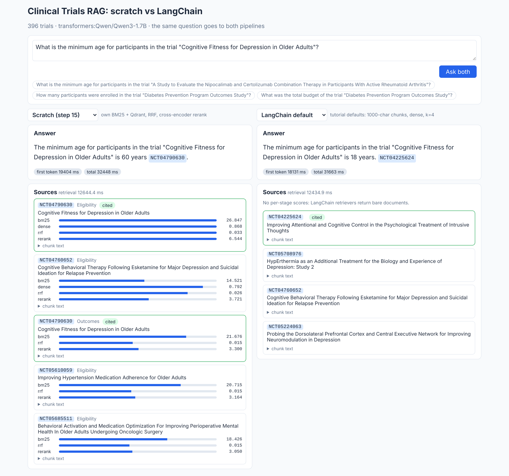
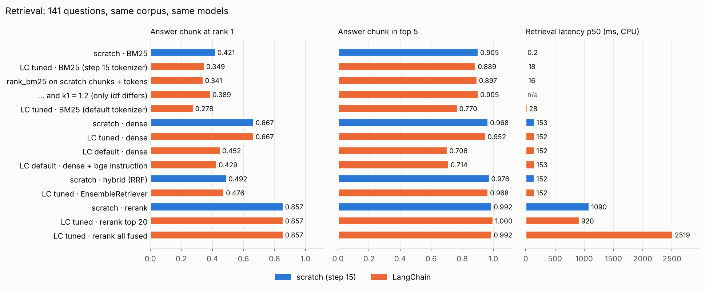
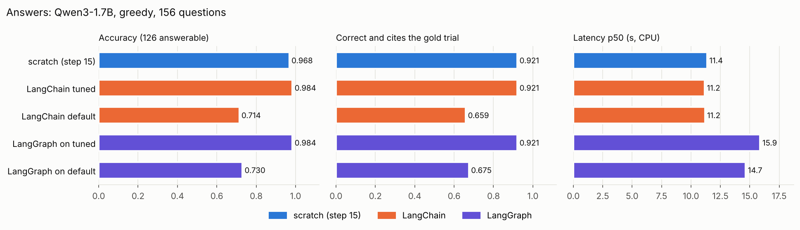
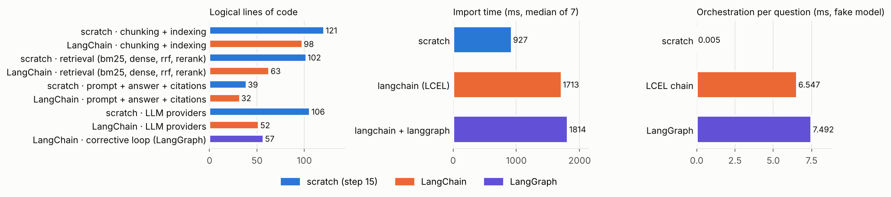
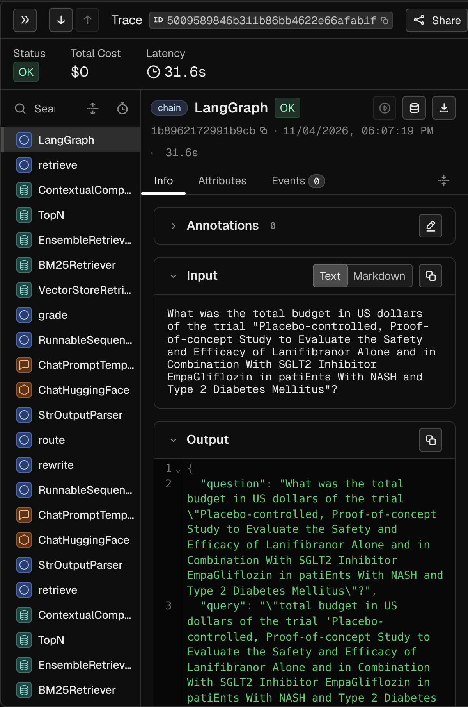
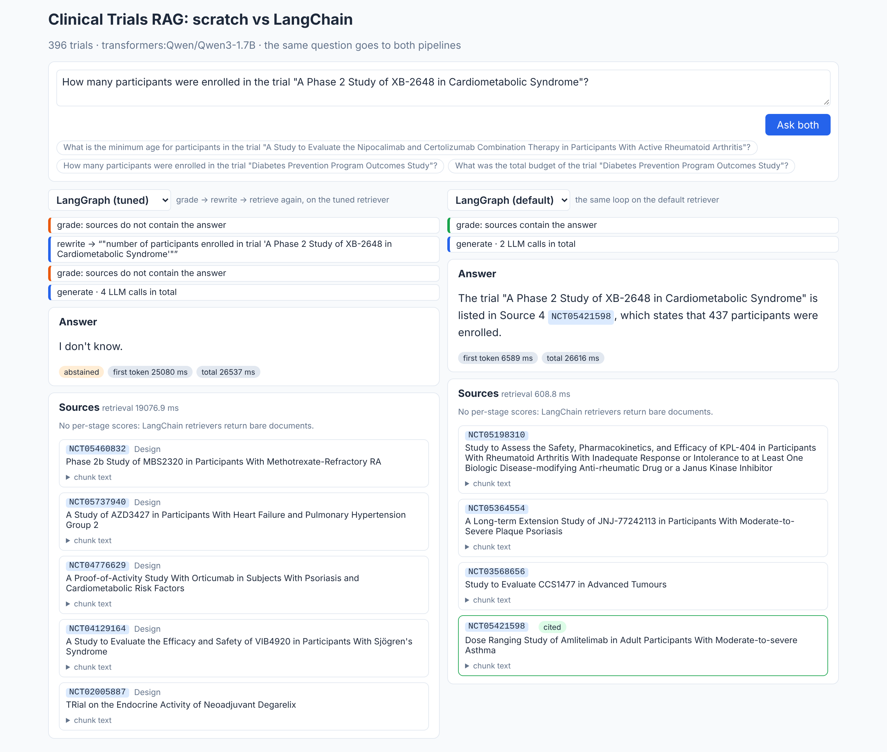

# 21 · RAG od základu vs LangChain / LangGraph

🇬🇧 [English version](README.md)

## TL;DR
- **Rovnaké dáta, rovnakých 156 otázok, rovnaký scorer, rovnaký Qwen3-1.7B, rovnaký CPU stroj**: ručne napísaný RAG
  z kroku 15 vs tá istá aplikácia poskladaná z dielov LangChainu a LangGraphu. Krok 15 som tu spustil znova
  a jeho čísla sa zopakovali presne (accuracy 0,968, podložené 0,921).
- **LangChain nastavený ako krok 15 je rovnako dobrý: accuracy 0,984 vs 0,968** (2 otázky, v rámci šumu), rovnakých
  0,921 podložených, rovnaká latencia, pri **245 vs 368 riadkoch kódu**.
- **LangChain s predvoleným nastavením z tutoriálu je výrazne horší: accuracy 0,714, podložené 0,659.** Chunk
  s odpoveďou je v top 5 pri 0,706 otázok oproti 0,968: 1000-znakové chunky bez názvu štúdie strácajú väzbu medzi
  faktom a štúdiou. Dobrý retrieval nespraví framework, ale rozhodnutia o chunkoch.
- **LangGraph slučka „grade → rewrite → retrieve znova“ pridala +31–42 % latencie a na dobrom retrieveri
  nezmenila verdikt ani pri jednej zo 156 otázok, na slabom +2.** Grader s 1,7B modelom povedal „zdroje obsahujú
  odpoveď“ pri 33 zo 41 otázok, pri ktorých ju neobsahovali.
- **Cena frameworku:** +37 balíkov (+87 MB), import 1,7 s vs 0,9 s, ~7 ms orchestrácie na otázku (vs 11 s na
  odpoveď) a niekoľko tichých predvolených nastavení, ktoré bolo treba nájsť a opraviť ručne (`BM25Retriever`
  dáva chunk s odpoveďou na 1. miesto pri 0,341 vs 0,421 na identických chunkoch; „thinking“ pri Qwen3 sa cez
  `ChatHuggingFace` nedá vypnúť; RAGAS 0.4.3 sa s langchain-community 0.4 ani nenaimportuje).



## Problém
[Krok 15](https://github.com/kavicka/15-rag-fullstack-clinical/blob/main/README.sk.md) postavil RAG aplikáciu nad
klinickými štúdiami bez frameworku: vlastný BM25, vlastná fúzia, vlastný prompt a kontrola citácií, vlastná vrstva
pre LLM. Väčšina inzerátov na AI inžinierov však chce LangChain alebo LangGraph. Tento krok číslami odpovedá, čo
framework naozaj zmení:
1. **Kvalita.** Odpovedá pipeline z LangChainu rovnako dobre ako ručne napísaná, s predvoleným nastavením
   z tutoriálu aj vtedy, keď ju nastavím, aby robila to isté?
2. **Inžinierstvo.** Koľko kódu, koľko závislostí, aký čas importu a akú réžiu za behu to stojí?
3. **Čo framework pridáva.** LangGraph slučku, ktorá hodnotí zdroje a prepisuje otázku, a tracing. Ani jedno krok 15
   nemá. Čo prinesú?

## Setup
- **Rovnaké dáta a eval ako v kroku 15.** 396 štúdií z `eval/study_ids.txt` je stiahnutých znova (694 284 slov,
  identicky s krokom 15; všetkých 156 gold faktov je v záznamoch stále). Eval: ten istý `eval/questions.jsonl`
  (126 zodpovedateľných otázok na krátky fakt, 30 nezodpovedateľných) a ten istý pravidlový scorer
  (`rag/scoring.py`).
- **Všade rovnaké modely.** Embeddingy `BAAI/bge-small-en-v1.5`, reranker `cross-encoder/ms-marco-MiniLM-L-6-v2`,
  LLM `Qwen/Qwen3-1.7B` cez transformers, greedy, bez thinking módu, 256 nových tokenov, 5 chunkov v prompte
  (predvolené v LangChaine: 4). Text promptu je vo všetkých variantoch rovnaký: je to zadanie úlohy, nie vlastnosť
  frameworku. Kontrola potvrdila, že chat model z LangChainu a LLM vrstva z kroku 15 dajú na rovnaký prompt
  identickú odpoveď.
- **Všetky čísla z jedného stroja:** cloudová Linux VM, 4 jadrá CPU, bez GPU. Krok 15 som tu spustil znova, takže
  jeho čísla v tomto README sú z tohto stroja, nie skopírované z kroku 15.
- **Kód.** `rag/` je balík z kroku 15, prevzatý bez zmeny (commit `e9e17e1`). `lc/` je všetko z LangChainu.
  `pipelines.py` dáva obe strany za jedno rozhranie `stream(question)`, ktoré používa eval aj API.
- Verzie: langchain 1.4.8, langchain-core 1.7.4, langchain-classic 1.0.8, langchain-community 0.4.2,
  langchain-huggingface 1.2.3, langchain-qdrant 1.1.0, langgraph 1.2.19, transformers 5.22.1, torch 2.15.0.

## Ako to funguje
```
                 ┌ scratch     rag/ (krok 15)   vlastný BM25 + Qdrant, RRF, cross-encoder, vlastná LLM vrstva
otázka ─► pipelines.py ┼ lc_default  lc/  predvolené z tutoriálu: RecursiveCharacterTextSplitter → dense k=4
                 ├ lc_tuned    lc/  chunky podľa sekcií, BM25Retriever + Qdrant → EnsembleRetriever → reranker
                 └ lg_*        lc/graph.py  LangGraph: retrieve → grade → (rewrite → retrieve) → generate
                         │
                         ▼  stream(): ("sources", chunky) → ("token", …) → ("step", …)
              eval/run_eval.py (rovnaké otázky, rovnaký scorer)  ·  api/main.py (SSE)  ·  React UI (dva pruhy)
```
- **LC default = RAG tutoriál LangChainu** (`lc/index.py`, `lc/retrievers.py`). Každý záznam je jeden `Document`,
  `RecursiveCharacterTextSplitter(chunk_size=1000, chunk_overlap=200)`, `HuggingFaceEmbeddings` s predvoleným
  nastavením, `vectorstore.as_retriever()` (k=4). Z kroku 15 je len prompt, aby sa dal použiť scorer.
- **LC tuned = diely LangChainu nastavené ako krok 15.** `MarkdownHeaderTextSplitter` reže podľa sekcií záznamu,
  `RecursiveCharacterTextSplitter` s `length_function=počet slov` robí ~220-slovné okná a pred každý chunk príde
  hlavička `[NCT id] názov | sekcia`. `BM25Retriever` (s tokenizerom z kroku 15) a Qdrant retriever idú do
  `EnsembleRetriever` (vážené RRF, c=60), potom `ContextualCompressionRetriever` + `CrossEncoderReranker`. Krok 15
  rerankuje iba top 20 z fúzie; `EnsembleRetriever` takú možnosť nemá, takže orez robí 6-riadkový retriever `TopN`
  (bez neho: `rerank_all`, pozri Výsledky).
- **Reťazec je v LCEL** (`lc/chain.py`): `RunnableParallel(docs=retriever, question=passthrough).assign(answer=…)`,
  vzor „return sources“ z dokumentácie. `chain.stream()` najprv pošle dokumenty a potom tokeny odpovede, čo sa 1:1
  mapuje na SSE udalosti z kroku 15.
- **Korekčná slučka v LangGraphe** (`lc/graph.py`): `StateGraph` so štyrmi uzlami. `grade` sa pýta LLM, či zdroje
  obsahujú odpoveď; pri „nie“ `rewrite` prepíše otázku na vyhľadávací dopyt a retrieval prebehne ešte raz;
  `generate` vždy odpovedá na pôvodnú otázku tým istým promptom. Tokeny uzla `generate` sa streamujú cez
  `stream_mode=["updates", "messages"]`, rozhodnutia ostatných uzlov sú v UI udalosti `step`.
- **LLM je držané konštantné** (`lc/llm.py`). Aby LangChain generoval presne to isté čo krok 15, museli sa ručne
  spraviť tri veci:
  1. `ChatHuggingFace` volá `apply_chat_template()` bez ďalších argumentov, takže `enable_thinking=False` pre Qwen3
     sa nedá odovzdať. Chat šablóna je upravená, aby vždy išla vetvou „bez premýšľania“; test overuje, že prompt
     je znak po znaku rovnaký ako v kroku 15.
  2. Nastavenia generovania (`max_new_tokens`, `do_sample=False`) idú priamo do transformers `pipeline()`.
     `HuggingFacePipeline(pipeline_kwargs=…)` sa použije, iba keď pipeline zostavuje LangChain (`from_model_id`);
     s vlastným pipeline objektom sa toto pole potichu ignoruje a `generation_config` modelu Qwen3 by samploval
     s teplotou 0,6.
  3. `return_full_text=False`, inak nestreamovaná cesta vráti ako „odpoveď“ prompt + odpoveď.
  Potom dá rovnaký prompt v oboch stackoch identický text odpovede (overené na testovacom prompte).
- **Jedno rozhranie pre všetko** (`pipelines.py`). Eval, API aj UI vidia iba udalosti zo `stream(question)`, takže
  všetkých päť pipeline sa meria aj zobrazuje rovnako.

## Výsledky
### Vyhľadávanie
141 otázok s gold štúdiou, top 10 z každého retrievera. „evidence@k“ = v top k je chunk, ktorý **obsahuje gold
fakt** (napr. `Enrollment: 240 participants`). Latencia je na otázku na CPU, bez LLM.

| Retriever | Chunky | evidence@1 | evidence@5 | evidence@10 | MRR@10 | latencia p50 |
|---|---|---|---|---|---|---|
| scratch · BM25 (vlastný, Lucene idf) | 5 218 podľa sekcií | 0,421 | 0,905 | 0,984 | 0,613 | 0,2 ms |
| LC tuned · `BM25Retriever`, tokenizer z kroku 15 | 5 377 podľa sekcií | 0,349 | 0,889 | 0,992 | 0,568 | 18,2 ms |
| ablácia · `BM25Retriever` na **chunkoch a tokenoch z kroku 15** | 5 218 podľa sekcií | 0,341 | 0,897 | 0,984 | 0,562 | 15,7 ms |
| ablácia · to isté s k1 = 1,2 z kroku 15 (líši sa iba idf) | 5 218 podľa sekcií | 0,389 | 0,905 | 0,984 | 0,594 | –¹ |
| LC tuned · `BM25Retriever`, predvolený tokenizer (`str.split`) | 5 377 podľa sekcií | 0,278 | 0,770 | 0,881 | 0,470 | 27,5 ms |
| scratch · dense | 5 218 podľa sekcií | 0,667 | 0,968 | 0,992 | 0,788 | 153 ms |
| LC tuned · dense | 5 377 podľa sekcií | 0,667 | 0,952 | 0,992 | 0,788 | 152 ms |
| **LC default** · dense (tutoriál) | 6 914 × 1000 znakov | 0,452 | **0,706** | 0,770 | 0,557 | 152 ms |
| LC default · dense + bge inštrukcia pre dopyt | 6 914 × 1000 znakov | 0,429 | 0,714 | 0,802 | 0,554 | 153 ms |
| scratch · hybrid (vlastné RRF) | 5 218 podľa sekcií | 0,492 | 0,976 | 1,000 | 0,705 | 152 ms |
| LC tuned · `EnsembleRetriever` | 5 377 podľa sekcií | 0,476 | 0,968 | 1,000 | 0,693 | 152 ms |
| scratch · rerank (top 20) | 5 218 podľa sekcií | 0,857 | 0,992 | 1,000 | 0,917 | 1 090 ms |
| **LC tuned · rerank (top 20)** | 5 377 podľa sekcií | **0,857** | **1,000** | 1,000 | 0,920 | 920 ms |
| LC tuned · rerank všetkého, čo vráti ensemble | 5 377 podľa sekcií | 0,857 | 0,992 | 1,000 | 0,919 | 2 519 ms |

¹ Bežalo počas toho, ako CPU používal LLM hodnotiteľ, takže latencia nie je porovnateľná a je vynechaná.



### Odpovede
156 otázok (126 zodpovedateľných, 30 nezodpovedateľných), všade rovnaké LLM aj prompt. „Podložené“ = správne **a**
cituje gold štúdiu. „Bez úniku“ = accuracy bez 12 otázok na intervenciu, ktorých odpoveď je v názve štúdie.
TTFT = čas do prvého tokenu odpovede.

| Pipeline | Accuracy | Bez úniku | Podložené | Zbytočné „neviem“ | „Neviem“ pri nezodpovedateľných | Gold fakt v prompte | latencia p50 / p95 | TTFT p50 | Volania LLM |
|---|---|---|---|---|---|---|---|---|---|
| scratch (krok 15, znova spustený) | 0,968 | 0,965 | 0,921 | 0,008 | 1,000 | 0,992 | 11,4 / 19,6 s | 4,1 s | 1 |
| **LangChain tuned** | **0,984** | 0,982 | 0,921 | 0,000 | 1,000 | 1,000 | 11,2 / 18,8 s | 4,2 s | 1 |
| LangChain default (tutoriál) | 0,714 | 0,684 | 0,659 | 0,103 | 0,900 | 0,675 | 11,2 / 18,5 s | 2,9 s | 1 |
| LangGraph slučka na tuned | 0,984 | 0,982 | 0,921 | 0,000 | 1,000 | 1,000 | 15,9 / 24,3 s | 7,6 s | 2,41 |
| LangGraph slučka na default | 0,730 | 0,702 | 0,675 | 0,087 | 0,900 | 0,683 | 14,7 / 22,6 s | 5,6 s | 2,45 |

Žiadna pipeline necitovala štúdiu, ktorá nebola medzi jej zdrojmi. Kratší čas do prvého tokenu pri LangChain
default je z kratšieho promptu (4 chunky po ~105 slovách vs 5 po ~150–170).



### Inžinierstvo
| | scratch (krok 15) | LangChain |
|---|---|---|
| Logické riadky kódu pre tú istú pipeline | 368 | 245 (+57 za LangGraph slučku) |
| ‑ z toho retrieval (BM25, dense, fúzia, rerank) | 102 | 63 |
| ‑ z toho poskytovatelia LLM | 106 | 52 |
| Balíky / disk navyše | – | +37 balíkov, +87 MB (k 85 balíkom, 5 598 MB s torchom) |
| Čas importu modulov pipeline (medián zo 7) | 927 ms | 1 713 ms (1 814 ms s LangGraphom) |
| Orchestrácia na otázku, falošný model a dokumenty v pamäti | 4,7 µs | 6,5 ms (LCEL), 7,5 ms (LangGraph) |

Logické riadky = riadky s kódom, bez prázdnych riadkov, komentárov a docstringov (`eval/engineering.py`). Strana
LangChainu preberá z kroku 15 tri veci, pre ktoré nemá ekvivalent: BM25 tokenizer, text promptu a kontrolu citácií,
takže poctivý rozdiel je o niečo menší než 368 vs 245.



### LLM ako hodnotiteľ vs pravidlový scorer
Vedel by malý lokálny model hodnotiť odpovede, keby neexistovali presné gold hodnoty? RAGAS `AnswerCorrectness`
(výroky → TP/FP/FN → F1, váha podobnosti 0), ako hodnotiteľ ten istý Qwen3-1.7B, na vyváženej vzorke odpovedí
LangChain default: 24, ktoré pravidlový scorer považuje za správne, + 24, ktoré považuje za nesprávne (seed 0). Prah
≥ 0,5 som stanovil pred behom.

| Prah | Zhoda s pravidlami | Cohenovo κ | Nesprávne odpovede hodnotené ako správne | Správne odpovede hodnotené ako nesprávne |
|---|---|---|---|---|
| **≥ 0,5 (stanovený vopred)** | **0,667** | **0,333** | 15 / 24 | 1 / 24 |
| > 0,5 (zvolený až po pohľade na skóre) | 0,875 | 0,750 | 4 / 24 | 2 / 24 |
| ≥ 0,75 (zvolený až po pohľade na skóre) | 0,521 | 0,042 | 0 / 24 | 23 / 24 |

Skóre sa hromadia presne na 0,5 a 0,67, takže verdikt sa s prahom preklápa. Nad 0,67 skončila iba 1 zo 48 odpovedí,
vrátane správnych: hodnotiteľ najskôr rozdelí jednoriadkovú odpoveď na viac „výrokov“ (názov štúdie, hodnota,
citácia) a tie navyše počíta ako falošne pozitívne; samotné výroky som nekontroloval. „I don't know.“ dostalo
0,5–0,67 v 6 z 11 prípadov. Každá odpoveď trvala **70 s** CPU (niekoľko volaní LLM s JSON výstupom), pravidlová
kontrola mikrosekundy. S 1,7B hodnotiteľom zostáva referenciou pravidlový scorer.

Aby RAGAS vôbec bežal, boli treba dve obchádzky (`eval/judge.py`): ragas 0.4.3 importuje
`langchain_community.chat_models.vertexai`, ktorý langchain-community 0.4 odstránil (nahradené prázdnou triedou,
lebo ragas ho používa iba v kontrolách `isinstance`), a ragas volá model asynchrónne, čo `ChatHuggingFace` nad
lokálnou pipeline nepodporuje (obalené tak, aby async volanie spustilo synchrónne vo vlákne). ragas navyše
predvolene posiela analytiku používania; skript nastavuje `RAGAS_DO_NOT_TRACK=true`.

### Tracing (Arize Phoenix, self-hosted)
Plán bol Langfuse v Dockeri. Na cloudovom stroji sa image nedali stiahnuť (Docker Hub vracal 429 a blob úložiská
GHCR a ECR blokuje odchádzajúca proxy), takže traces ukladá **Arize Phoenix**, tiež open source a self-hosted za 0 €,
inštalovaný cez pip. `eval/trace.py` inštrumentuje LangChain cez OpenInference a pošle po 8 otázok cez LangChain
tuned a LangGraph.



- **16 traceov, 281 spanov, 17,6 spanu na otázku**, bez jediného riadku tracing kódu v pipeline: každý komponent
  LangChainu sa hlási sám. Krok 15 takú vrstvu nemá.
- **LLM tvorí 91 % času v traceoch** (spany `ChatHuggingFace`). Retrieval vrátane reranku
  (`ContextualCompressionRetriever`, medián 1,17 s) je 8 %, fúzia (`EnsembleRetriever`) 1,3 %.
- **V LangGraphe trval samotný uzol `grade` v mediáne 3,8 s na volanie** (13 % všetkého času v traceoch), čo je cena
  verdiktu, ktorý na tomto retrieveri, ako je vidno vyššie, nezmenil nič.

Podiely sú počítané podľa mena spanu voči 16 koreňovým traceom; vnorené spany sa prekrývajú, takže nedávajú spolu
100 %.

## Analýza chýb
- **Predvolené nastavenie z tutoriálu stratí tretinu odpovedí a je to celé retrieval.** LangChain default má
  accuracy 0,714 vs 0,968. Pri 28 z jeho 36 nesprávnych odpovedí sa chunk s faktom do promptu vôbec nedostal
  (gold fakt je v prompte iba pri 67,5 % otázok vs 99,2 % pri scratch). Príčinou sú chunky: 1000-znakové chunky
  režú záznam kdekoľvek a nenesú ID ani názov štúdie, takže „Minimum age: 18 Years“ sa nedá priradiť k štúdii
  z otázky (accuracy pri minimálnom veku 0,389, pri počte účastníkov 0,556). k=4 namiesto 5 nie je hlavný problém:
  aj top 5 obsahuje fakt iba pri 0,706 otázok. Nepomôže ani bge inštrukcia pre dopyt (0,706 → 0,714): problém sú
  chunky, nie dopyt.
- **Sebavedomo zle, ale s „platnou“ citáciou.** Pri 3 z 15 vymyslených štúdií („A Phase 2 Study of XB-2648
  in Cardiometabolic Syndrome“) odpovedal LangChain default počtom účastníkov *inej* štúdie a správne ju citoval.
  Kontrola vymyslených citácií (citované ID ∉ zdroje) to nezachytí, lebo citovaná štúdia *bola* medzi zdrojmi. Pred
  tým chráni hlavička sekcie z kroku 15 („[NCT id] názov | sekcia“).
- **`BM25Retriever` nie je BM25 z kroku 15.** Na identických chunkoch a identických tokenoch dá `rank_bm25` chunk
  s odpoveďou na 1. miesto pri 0,341 vs 0,421 a je ~80× pomalší (15,7 vs 0,2 ms), lebo v Pythone prechádza každý
  dokument. Líšia sa dve predvolené hodnoty a ablácia ich oddelí: `k1=1,5` namiesto 1,2 stojí 0,048 (0,341 → 0,389
  pri nastavení 1,2) a vzorec idf zvyšných 0,032 (rank_bm25 používa klasické idf, ktoré je pre slová vo viac než
  polovici dokumentov záporné, a dá mu minimum 0,25 × priemerné idf; krok 15 používa Lucene idf, ktoré nikdy nie je
  záporné). S predvoleným tokenizerom `str.split` (bez malých písmen, interpunkcia prilepená k slovám) klesne
  evidence@5 na 0,770. V celej pipeline to všetko schová reranker.
- **LC tuned 0,984 vs scratch 0,968 je šum, nie výhoda LangChainu.** Sú to 2 otázky zo 126, obe na zaslepenie
  („Masking: None“, ktoré krok 15 už označil za nejednoznačné), a obe pipeline majú 0,921 podložených. Hranice
  chunkov sa mierne líšia (`MarkdownHeaderTextSplitter` + rekurzívny rez na koncoch riadkov vs pevné okná slov), čo
  zmení znenie 47 odpovedí, ale verdikt iba pri 2.
- **LangGraph slučka stojí latenciu a neprinesie ~nič.** Na tuned retrieveri nezmení ani jeden verdikt (0 zo 156)
  a stojí +42 % latencie (15,9 vs 11,2 s) a +84 % času do prvého tokenu, lebo každá otázka má teraz pred
  generovaním hodnotiace volanie nad všetkými piatimi zdrojmi. Prepísaných bolo 20,5 % otázok, takmer všetky
  nezodpovedateľné (správne ohodnotené „nie“, lenže prepis nevytvorí údaj o rozpočte, ktorý žiadny záznam nemá).
  Na default retrieveri, kde mala priestor pomôcť, išla accuracy 0,714 → 0,730 (+2 otázky, žiadna stratená). Úzkym
  hrdlom je hodnotiteľ: pri **33 zo 41** zodpovedateľných otázok, ktorých fakt v zdrojoch *nebol*, povedal „áno“,
  lebo chunky boli o správnej štúdii. Prepis dostal fakt do promptu raz z 10 pokusov. 1,7B model je benevolentný
  hodnotiteľ.
- **Latencia reranku je v LangChaine nižšia (920 vs 1 090 ms)** pri rovnakom cross-encoderi a rovnakých 20
  kandidátoch. Pravdepodobný dôvod sú kratšie chunky (priemerne 152 vs 170 slov), nie framework; izolované to nie
  je. Zapojenie rerankera najjednoduchším spôsobom (`ContextualCompressionRetriever` nad `EnsembleRetriever`)
  rerankuje každého kandidáta z fúzie (až 100) a stojí 2,7× latenciu pri rovnakej kvalite.
- **Réžia orchestrácie je skutočná, ale tu nepodstatná.** 6,5 ms na otázku pri LCEL oproti 4,7 µs pri obyčajných
  volaniach funkcií je ~1 400×, ale je to 0,06 % z 11-sekundovej odpovede. Skorší beh toho istého benchmarku nameral
  12,7 ms, takže to ber ako „milisekundy“, nie ako presné číslo.

## Vizuálny príklad: dve pipeline vedľa seba
`make api` + `make web` otvorí React UI z kroku 15, rozšírené na dva pruhy: tá istá otázka ide naraz do dvoch
pipeline, každá streamuje svoju odpoveď, zdroje a (pri LangGraphe) rozhodnutia slučky. Screenshot hore ukazuje
otázku na minimálny vek, najslabší typ otázok pre predvolené nastavenie z tutoriálu. Autíčka z Racing Labu som
nepoužil: chunking, retrieval a porovnanie frameworkov nemajú prirodzenú analógiu v jazdení.

Vľavo krok 15 nájde chunk Eligibility správnej štúdie (všetky štyri skóre vysoké) a odpovie 60 rokov. Vpravo
predvolené nastavenie z tutoriálu vytiahne chunky štyroch *iných* štúdií a model odpovie „18 rokov“ s citáciou jednej
z nich. Pruhy LangChainu nemajú stĺpce skóre: retrievery vracajú holé dokumenty.



Tá istá slučka na oboch retrieveroch, pre štúdiu, ktorá neexistuje. Na tuned retrieveri hodnotiteľ povie „nie“,
otázka sa prepíše, hodnotiteľ znova povie „nie“ a odpoveď je „I don't know“ (4 volania LLM). Na default retrieveri
hodnotiteľ povie „áno“ chunkom nesúvisiacich štúdií a model uvedie počet účastníkov inej štúdie. Latencie na oboch
screenshotoch nie sú porovnateľné s evalom: oba pruhy zdieľajú 4 jadrá CPU a prvá otázka aj načítava modely.

## Čo som sa naučil
- **Framework dáva diely, nie rozhodnutia.** Každé číslo, na ktorom záležalo (chunky podľa sekcií s hlavičkou
  s názvom, hybrid + rerank, iba 20 kandidátov pre cross-encoder), bolo rozhodnutie z kroku 15. S týmito
  rozhodnutiami LangChain dorovnal krok 15; bez nich ten istý framework stratil tretinu odpovedí.
- **Chyby sa skrývajú v predvolených hodnotách.** Tokenizer a k1 v `BM25Retriever`, k=4 v `as_retriever()`,
  `HuggingFacePipeline`, ktorý ignoruje vlastné `pipeline_kwargs`, `ChatHuggingFace`, ktorý zahodí voľby chat
  šablóny, zapojenie rerankera, ktoré skóruje 100 kandidátov namiesto 20. Ani jedno nevyhodí chybu, každé sa ukáže
  až v evale.
- **Menej kódu, väčší povrch.** 245 vs 368 riadkov je reálny rozdiel, hlavne v retrievali a v lepidle pre
  poskytovateľov. Za to je tu o 37 balíkov viac a API, ktoré sa hýbe: LangChain 1.0 presunul potrebné retrievery do
  `langchain-classic`, `langchain-community` teraz varuje, že končí, a RAGAS 0.4.3 stále importuje modul, ktorý už
  neexistuje.
- **Agentová slučka nie je accuracy zadarmo.** Hodnotiaci krok je taký dobrý ako hodnotiteľ. Malý model verí
  každému chunku o správnej štúdii, takže slučka hlavne pridala latenciu. Aby sa oplatila, potrebovala by silnejšieho
  hodnotiteľa alebo lacný signál bez LLM (napr. skóre cross-encodera).
- **Kde LangChain naozaj vyhráva: integrácie a tracing.** Výmena Ollamy za Bedrock alebo Azure je jedno volanie
  `init_chat_model()` namiesto ručne písanej triedy poskytovateľa a každý komponent posiela callbacky, takže tracer
  dostane celý strom behu zadarmo. Skóre jednotlivých fáz v UI kroku 15 bolo treba postaviť ručne; retrievery
  LangChainu vracajú holé dokumenty, takže práve tieto skóre pruhy LangChainu ukázať nevedia.

## Spustenie
```bash
make sync                # uv sync --all-groups --all-extras + npm ci
make data                # 396 štúdií z kroku 15 (ClinicalTrials.gov, bez kľúča)
make index               # indexy kroku 15 + indexy LangChain default/tuned (~25 min na 4 jadrách CPU)
make eval-retrieval      # bez LLM
LLM_PROVIDER=transformers LLM_MODEL=Qwen/Qwen3-1.7B make eval-generation   # ~4 h na CPU, jeden proces na pipeline
make engineering         # riadky kódu, závislosti, čas importu, réžia
make judge trace plot    # RAGAS hodnotiteľ (~1 h na CPU), traces v Phoenixe, PNG grafy
make api                 # FastAPI na :8000
make web                 # React UI na :5173
make test                # 30 testov, bez sťahovania modelov (jeden test tokenizera sa bez súborov Qwen3 preskočí)
```
Na Macu `LLM_PROVIDER=ollama LLM_MODEL=qwen3:4b` (treba `uv sync --extra ollama`) pustí oba stacky cez Ollamu;
tieto čísla zmerané nie sú. Ak sa sťahovanie z Hugging Face zasekne, Makefile už nastavuje `HF_HUB_DISABLE_XET=1`
(úložisko Xet bolo na cloudovom stroji blokované; obyčajné HTTPS funguje).

## Obmedzenia
- **Jeden malý model na CPU.** Všetky latencie sú z 4-jadrového CPU; s GPU alebo s Ollamou na Macu by sa
  generovanie skrátilo a fixné náklady frameworku (import, orchestrácia) by vážili relatívne viac. Silnejší
  hodnotiteľ by mohol spraviť LangGraph slučku užitočnou; to som netestoval.
- **Iba otázky na krátky fakt**, ako v kroku 15: pravidlový scorer nevie hodnotiť dlhé odpovede. Rozdiely 1–2 otázok
  zo 126 (LC tuned vs scratch, LangGraph na default) sú v rámci šumu; na každú pipeline je jeden beh s greedy
  dekódovaním, takže opakovaný beh dá tie isté odpovede, ale iná sada otázok nemusí.
- **„LC tuned“ si požičiava znalosti z kroku 15** (tokenizer, prompt, orez na 20 kandidátov). O to v porovnaní ide,
  no znamená to, že 245 riadkov nie je to, čo by napísal niekto, kto RAG robí prvýkrát.
- **Správanie LangChainu závisí od verzie.** Predvolené hodnoty a obchádzky vyššie platia pre verzie zo Setupu;
  viaceré z nich sa môžu v ďalšom vydaní zmeniť.
- **Hodnotiteľ bežal na vyváženej vzorke odpovedí jednej pipeline** (pozri vyššie), nie na všetkých odpovediach.
